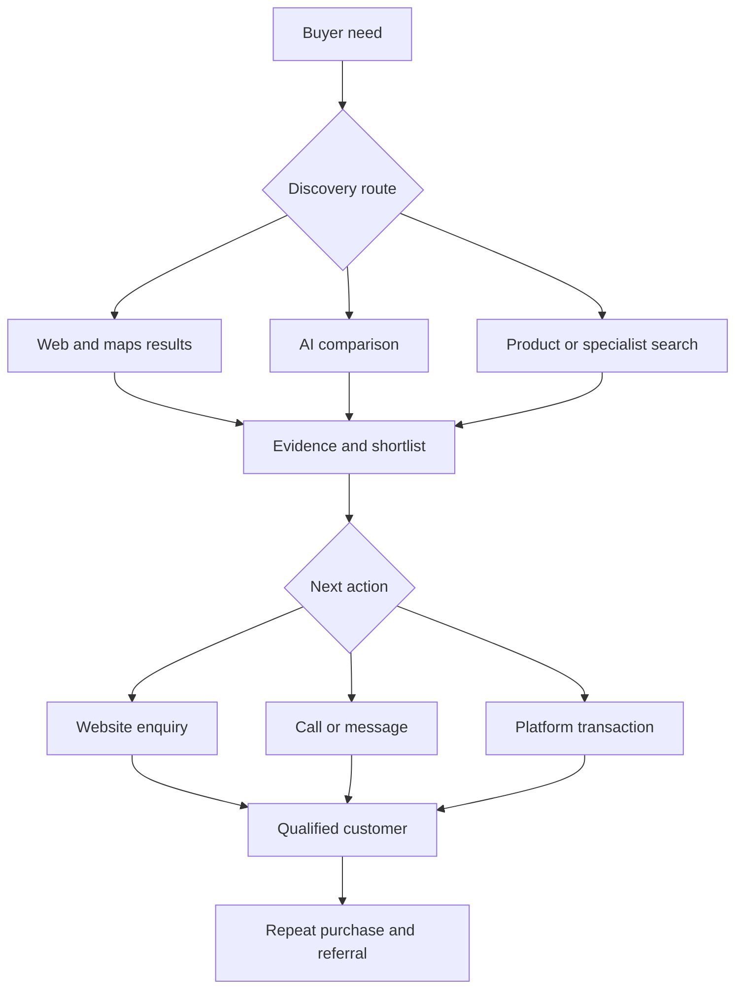

# The Future of Business Through Search Engines

## How businesses can earn customers in a world of Google, Bing, AI answers, and shopping agents

**Edition:** 1.0 · **Evidence cutoff:** 10 November 2026 · **Planning horizons:** 2027–2028, 2029–2030, and 2031–2035.

**Audience:** founders, business owners, researchers, and marketing operators. Global scope, with a practical India chapter. Written in plain English; a [Malayalam guide](MALAYALAM.md) accompanies this book.

**Reading convention:** sourced observations are marked **Evidence**; interpretations and proposed actions are **Analysis** or **Recommendation**. Future outcomes are **Scenarios**, not predictions with known probabilities. All numerical business examples are **Illustrations**, not measured benchmarks. Source IDs link to the [source register](SOURCES.md).

## Contents

1. [The central finding](#1-the-central-finding)
2. [What business through search actually means](#2-what-business-through-search-actually-means)
3. [What the evidence says about traffic and value](#3-what-the-evidence-says-about-traffic-and-value)
4. [How to interpret conflicting studies](#4-how-to-interpret-conflicting-studies)
5. [The changing customer journey](#5-the-changing-customer-journey)
6. [Google: the largest immediate opportunity](#6-google-the-largest-immediate-opportunity)
7. [Bing and Microsoft: a second distribution system](#7-bing-and-microsoft-a-second-distribution-system)
8. [ChatGPT, Perplexity, and other search services](#8-chatgpt-perplexity-and-other-search-services)
9. [Global markets require different plans](#9-global-markets-require-different-plans)
10. [Which business models face pressure](#10-which-business-models-face-pressure)
11. [What makes a business worth recommending](#11-what-makes-a-business-worth-recommending)
12. [A practical system for generating leads](#12-a-practical-system-for-generating-leads)
13. [Playbooks by business type](#13-playbooks-by-business-type)
14. [Paid search in an AI interface](#14-paid-search-in-an-ai-interface)
15. [How to measure business results](#15-how-to-measure-business-results)
16. [The economics of fewer clicks](#16-the-economics-of-fewer-clicks)
17. [India and starting without a large budget](#17-india-and-starting-without-a-large-budget)
18. [Business opportunities created by the transition](#18-business-opportunities-created-by-the-transition)
19. [Scenarios through 2035](#19-scenarios-through-2035)
20. [The forces that could change the outcome](#20-the-forces-that-could-change-the-outcome)
21. [A 90-day implementation plan](#21-a-90-day-implementation-plan)
22. [A research and decision system for the next decade](#22-a-research-and-decision-system-for-the-next-decade)
23. [Worked examples](#23-worked-examples)
24. [Questions that remain unanswered](#24-questions-that-remain-unanswered)
25. [Glossary](#25-glossary)

## 1. The central finding

**Analysis — high confidence in the direction, lower confidence in the speed:** search will remain a significant way to find customers, while more of the explanation, comparison, and selection happens before a visitor reaches the business's website. A business therefore needs to be discoverable, correctly understood, credible, and easy to buy from across several interfaces.

The important commercial question is: **when a person or an assistant looks for a solution, is there convincing evidence that this business can deliver it, and is there a reliable next step?** Ranking a page, receiving an AI citation, generating an enquiry, and closing a profitable sale are different outcomes.

This book supports five working conclusions:

1. Keep investing in useful search visibility where it produces profitable customers. A universal exit from SEO is not supported by the evidence.
2. Treat easily summarized informational traffic as more exposed than demand for a real service, original evidence, a specific product, or a transaction.
3. Develop information that helps a customer choose: suitability, price conditions, availability, proof, restrictions, delivery, and support.
4. Measure qualified leads, completed sales, refunds, and contribution after acquisition costs. Mentions and clicks are diagnostic measures.
5. Build direct customer relationships alongside discovery platforms so a change in one interface does not remove the whole route to market.

These are strategic recommendations, not claims that a particular page format or tool guarantees results. The strongest strategy combines an actual commercial advantage with information that makes that advantage visible.

## 2. What business through search actually means

**Analysis.** Search is an expression of intent. Someone is trying to understand a problem, compare alternatives, find a supplier, check a claim, or complete an action. A business can earn money by satisfying that intent directly or by helping another business serve it.

| Business relationship to search | How money is earned | Main dependency |
|---|---|---|
| A merchant or service provider finds customers | Product margin or service fee | Relevant discovery and delivery quality |
| A publisher attracts an audience | Advertising, subscriptions, sponsorship | Attention and willingness to visit or subscribe |
| An affiliate helps buyers choose | Commission on attributed transactions | Credible recommendation and attribution rules |
| A directory or marketplace matches buyers and sellers | Listing fee, lead fee, transaction fee | Current supply information and useful matching |
| A marketing operator helps clients acquire customers | Project or recurring service fee | Demonstrable commercial improvement |
| A data or software supplier supports search commerce | Data licence, software fee, service fee | Accurate information or difficult operational integration |

These models should not be treated as one market. A reduced click to an informational article can hurt an advertising publisher while a product recommendation creates a sale for a merchant. The platform may also earn more advertising revenue during the same period.

There are several different surfaces: ordinary web results, maps, product listings, images, video, AI summaries, conversational assistants, and agent-assisted transactions. Some lead to a website. Others lead directly to a call, message, booking, or checkout. A business needs to know which surface its intended customer uses for the relevant task.

**Recommendation.** Begin each project with one sentence: “We help [specific buyer] solve [specific problem] in [market], and we earn [margin or fee] when [commercial event] occurs.” Until that sentence is concrete, a large keyword list can create activity without a business.

## 3. What the evidence says about traffic and value

### 3.1 Traditional search remains commercially important

**Evidence.** Statcounter's October 2026 worldwide search referral table reports Google at 91.05% and Bing at 4.80%. Its method measures referrals to participating websites, not all searches or all assistant conversations. These percentages cannot be used as shares of total human information seeking. [S01](SOURCES.md#s01) [S02](SOURCES.md#s02)

Alphabet's Q3 2026 disclosure reports Google Search & other revenue of $63.350 billion, versus $56.567 billion a year earlier, approximately 12% growth. That accounting category is evidence of platform monetization, not a measure of how much traffic or profit an individual business receives. [S04](SOURCES.md#s04)

**Analysis.** An incumbent can retain large referral distribution and grow advertising revenue while some publishers lose clicks. This is a reason to evaluate search at the level of a particular business and buyer journey.

### 3.2 AI answers can reduce external clicks

**Evidence.** Pew studied browsing from 900 US adults during March 2025, including 68,879 unique Google searches. Traditional-result clicks occurred on 8% of visits with an AI summary versus 15% without one; clicks to summary sources occurred on about 1%. Search results were reconstructed in April, so exposure measurement and query differences constrain causal interpretation. [S05](SOURCES.md#s05)

Ahrefs' February 2026 update compared desktop Search Console data for 300,000 keywords between December 2023 and December 2025. It reported an association between AI Overview presence and a 58% lower average CTR for the top-ranking page. This is not a measured 58% reduction in every business's traffic or sales. [S06](SOURCES.md#s06)

### 3.3 The pattern is not a straight line

**Evidence.** Seer's April 2026 study covered 53 brands, 5.47 million tracked queries, and 2.43 billion organic impressions. In its table, organic CTR for queries showing an AI Overview rose from 1.31% in December 2025 to 2.36% in February 2026. Its sample and period differ from Ahrefs; the recovery does not establish a return to earlier conditions. [S07](SOURCES.md#s07)

Google announced further changes to link presentation in October 2026, including more prominent inline links and tests for task-specific destinations. A study of an earlier interface cannot automatically predict behaviour after these changes. [S45](SOURCES.md#s45)

### 3.4 Visitors from AI can be commercially valuable

**Evidence.** Adobe's October 2026 report describes September AI-referred traffic to US retail sites as growing 71% year over year and producing 83% higher revenue per visit than non-AI traffic. Its underlying retail analysis covers more than one trillion visits, 100 million SKUs, and 18 categories. This is an observed channel comparison, not proof that AI causes the same visitor to spend more. [S08](SOURCES.md#s08)

**Analysis.** Someone who has already compared options in an assistant may arrive closer to purchase. But the population may also differ in wealth, product mix, device, urgency, or brand preference. Higher value per visit does not establish that the channel is large enough to replace lost traffic elsewhere.

### 3.5 Experimental evidence strengthens, but does not settle, the case

**Evidence.** An August 2026 preprint reports a preregistered Google Search field experiment with 1,100 participants. Removing AI features increased publisher referrals; forcing an AI Mode experience reduced click-through and some user experience measures. The authors describe seven-day treatment exposure, a skewed participant sample, imperfect treatment compliance, and forced adoption as limitations. Treat the findings as short-term experimental evidence, not a settled prediction for all users. [S09](SOURCES.md#s09)

## 4. How to interpret conflicting studies

**Analysis.** Research becomes useful when its denominator is clear. “Traffic fell,” “AI traffic grew,” and “search revenue grew” can all be true because they measure different things.

| Measure | Denominator | What it can answer | What it cannot establish alone |
|---|---|---|---|
| Search-result CTR | Eligible impressions or observed search visits | How often exposure turns into clicks | Revenue, profit, or causal impact |
| AI citation frequency | Responses or citation events observed | Whether content is referenced | How many people bought |
| AI referral growth | Earlier AI referrals | Growth within a channel | Its share of all traffic |
| Revenue per visit | Visits in a particular channel | Average commercial yield per visit | Incremental revenue caused by the channel |
| Search ad revenue | Platform revenue category | Platform monetization | Advertiser profitability |
| Qualified lead rate | Valid enquiries | Buyer fit and readiness | Closed revenue without sales follow-through |

A careful comparison controls for query intent, country, language, device, brand versus non-brand demand, seasonality, ranking changes, and interface version. Few public studies isolate all of these. Agency studies often observe their own clients. Platform studies have broader internal access but commercial incentives. Public disclosures have clear accounting categories but little detail on small-business outcomes.

**Recommendation.** Use the external studies to identify risks and design experiments. Use the business's own matched cohorts to decide what to change. Do not take a global headline and multiply a local business's revenue by it.

A useful decision memo contains both supporting and opposing evidence. For example, the thesis “informational traffic is under pressure” is supported by the studies above. Counterweights include interface changes, partial CTR recovery, variation by intent, and higher observed value among some AI referrals. The result is a conditional strategy: reduce dependence on interchangeable information while preserving useful acquisition assets.

## 5. The changing customer journey

**Analysis.** A customer may discover a business through one system, verify it through another, and contact it directly later. The customer journey is increasingly difficult to reconstruct from a final click.

The diagram is a conceptual model, not measured journey data. It highlights three commercial tasks: becoming a candidate, helping the buyer verify the choice, and completing the transaction.

Consider an industrial buyer researching “food-grade pump supplier with local maintenance.” A general explanation may be answered immediately. The buyer still needs compatible materials, operating limits, delivery availability, certifications where relevant, and a credible quotation. A supplier that publishes and maintains this information can serve a need that a generic article cannot complete.

Similarly, a local customer may discover a repair business in Maps and call without visiting a site. That is a successful acquisition even though it appears as no website click. Conversely, a thousand visits to an unrelated tutorial may have no sales value.

**Recommendation.** Design a clear next action for each buyer stage. Early research may lead to a useful specification guide. Evaluation may lead to a comparison or example project. Purchase intent should lead to availability, a quote, an appointment, or checkout. Do not force every visitor through the same generic contact form.

## 6. Google: the largest immediate opportunity

### 6.1 Organic search and AI visibility

**Evidence.** Google's documentation says pages supporting AI answers must meet ordinary Search eligibility, including indexing and snippet eligibility. Its AI features may retrieve several related searches to answer a question. Inclusion is not guaranteed. [S10](SOURCES.md#s10)

Its current optimization guide says ordinary SEO remains relevant; special AI markup, prescribed page lengths, and `llms.txt` are not required to improve Google visibility. The guide explicitly rejects several popular optimization myths. [S11](SOURCES.md#s11)

**Recommendation.** Build useful, navigable pages describing the actual business and its offers. Make the central information visible as readable text. Provide direct evidence where a claim matters. An original compatibility table, a measured test, or a clearly documented service boundary is more useful commercially than dozens of rewrites of a common definition.

Do not turn “query fan-out” into an instruction to publish a separate page for every wording of a question. Organize pages around coherent buyer decisions. Separate pages are justified when the underlying need, offer, evidence, or geography genuinely differs.

### 6.2 Current controls and reporting

**Evidence.** Google's Search generative AI control lets owners manage inclusion in specified AI Search features; the documentation records global rollout by 31 August 2026. It is separate from ordinary Search inclusion and AI training controls. [S12](SOURCES.md#s12)

The dedicated Search generative AI report documents impressions and breakdowns by page, country, date, and device. A low-exposure property may not show the report. It is not a complete AI-specific click-to-sale attribution system. The launch announcement and current help page should take precedence over older claims that no separate reporting exists. [S13](SOURCES.md#s13) [S14](SOURCES.md#s14)

**Recommendation.** Record both ordinary performance and the available AI exposure measures. If a page gains impressions but produces no enquiries, inspect whether the offer is appropriate and whether the next step is easy. More visibility for the wrong audience can have little value.

### 6.3 Maps and local services

**Evidence.** Google identifies relevance, distance, and prominence as main considerations for local results and recommends accurate business information. Eligibility is limited: online-only businesses and lead generation companies are among the excluded categories. [S19](SOURCES.md#s19) [S20](SOURCES.md#s20)

**Recommendation.** For a genuine eligible business, maintain its real service area, contact details, opening hours, categories, photos, and customer feedback. Create a reliable process for answering legitimate enquiries. A misleading address or a profile for a fabricated local supplier undermines the business model.

Local demand remains an attractive hypothesis because a physical service has to be delivered somewhere. However, proximity limits reach, competition can be intense, and good discovery does not compensate for poor response or service quality.

### 6.4 Product discovery

**Evidence.** Merchant Center free listings can expose eligible products across Google surfaces, but submission does not guarantee display. Product and shipping information are part of the requirements. Merchant Center's online-store process includes verification and claiming of the store. [S21](SOURCES.md#s21) [S22](SOURCES.md#s22)

Product structured data supports eligible merchant listing experiences; Google recommends applying it to appropriate product pages and may verify the submitted information. [S23](SOURCES.md#s23)

**Recommendation.** Maintain a single reliable product record for identity, variants, price, availability, images, shipping, returns, and compatibility. Reconcile it with every distribution feed and product page. A feed error can cause a wrong recommendation even when the marketing copy is excellent.

## 7. Bing and Microsoft: a second distribution system

**Evidence.** Bing introduced AI Performance reporting in February 2026 for citations across Copilot, Bing AI summaries, and selected partner experiences. June additions include intent groups, topics, citation share, and comparisons in preview. Those measures describe participating Microsoft-visible surfaces; they are not a census of every assistant. [S15](SOURCES.md#s15) [S16](SOURCES.md#s16)

**Analysis.** Bing deserves an explicit role because it is a distinct discovery system and a source for some other services. But its relative value depends on the customers a business can profitably serve. A low global share can still contain a valuable buyer segment; the reverse is also possible.

**Recommendation.** Verify the website in Bing Webmaster Tools, inspect crawl and index issues, and observe commercially relevant landing pages. Where the publishing system supports it, use IndexNow to notify participating engines when information changes. IndexNow documentation makes clear that submission does not guarantee indexing. [S34](SOURCES.md#s34)

The business experiment is simple: does maintaining accurate content and correcting discovery issues produce qualified incremental demand? Avoid constructing an entirely separate content operation before evidence shows that it is necessary.

**Evidence.** Microsoft's current commerce page describes Copilot Checkout, feed requirements, and merchant responsibility. Eligibility is currently stated for English-language merchants selling to US buyers in USD. Some integrations remain staged or selective. [S25](SOURCES.md#s25)

**Analysis.** A business outside the US should distinguish its own location from the location of the buyers it serves. Eligibility still needs confirmation for its specific account, platform, products, and payment setup. The existence of a shopping feature is not evidence that every merchant can activate it immediately.

## 8. ChatGPT, Perplexity, and other search services

### 8.1 ChatGPT

**Evidence.** OpenAI's March 2026 commerce update emphasizes product discovery and says merchants can use their own checkout experiences after limitations in the initial Instant Checkout approach. Current shopping documentation distinguishes independently selected product results from separate ads. [S26](SOURCES.md#s26) [S27](SOURCES.md#s27)

OpenAI documents separate roles for its search crawler and training crawler. Allowing search access and allowing model-training collection are distinct choices. [S28](SOURCES.md#s28)

**Recommendation.** Make product and company facts accessible and accurate, inspect relevant search access settings, and evaluate current merchant feed options where eligible. Observe actual referrals and enquiries. Do not buy a service claiming guaranteed organic recommendation on the basis of an undocumented ranking formula.

### 8.2 Perplexity

**Evidence.** Perplexity documents a crawler for search discovery and a separate user-triggered fetcher. The old `/merchants` address redirected, during this research, to an ecommerce-related Computer sign-in page rather than the original merchant programme page. Current access to the old programme was therefore not established. [S29](SOURCES.md#s29) [S30](SOURCES.md#s30)

**Recommendation.** Treat ordinary search visibility and any merchant integration as separate questions. Verify the present programme, country support, terms, and onboarding route before making it part of a business plan.

### 8.3 Other services

| Service | Evidence reviewed | Practical interpretation |
|---|---|---|
| DuckDuckGo | Its help pages say traditional links and images largely come from Bing; advertising is available through Microsoft. [S31](SOURCES.md#s31) [S32](SOURCES.md#s32) | Bing accessibility can have value beyond Bing itself; do not assume identical ranking or audience behaviour. |
| Brave Search | Brave describes its own search index and AI answer experiences. [S33](SOURCES.md#s33) | Another route to discovery; measure relevant demand before allocating much effort. |
| Yandex | Webmaster guidance includes regional information and site-quality recommendations. [S37](SOURCES.md#s37) | Use market-specific implementation when serving its audience. |
| NAVER | The company announced AI Briefing across search, places, content, and shopping. [S36](SOURCES.md#s36) | A Korean-market strategy needs local platform and language knowledge. |
| Baidu | Its Q2 2026 disclosure reports continuing AI development alongside pressure on online marketing revenue. [S35](SOURCES.md#s35) | AI adoption does not ensure advertising growth for every incumbent; China needs separate research. |
| Yahoo, Ecosia, and other smaller services | Referral presence is visible in selected market tables; detailed current commercial integrations were not fully audited here. | Investigate when customer evidence justifies it; do not infer a universal network arrangement. |

**Analysis.** It is inefficient for a small business to build equal operations for every engine. Start where buyers already search, make the core information portable, and expand when marginal customer value supports the cost.

## 9. Global markets require different plans

**Analysis.** “Worldwide” is a scope, not a uniform customer. Language, purchasing power, payment habits, business verification, delivery, and platform availability change the acquisition process.

| Market situation | Research priority | Likely execution consequence |
|---|---|---|
| Domestic Indian service business | Local buyer language, real service area, response preferences | Local proof, mobile contact, accurate coverage |
| Indian exporter serving foreign buyers | Buyer specifications, commercial terms, delivery feasibility | Technical documentation and clear quotation workflow |
| US ecommerce merchant | Current eligibility for product feeds and checkout integrations | Product data and purchase completion experiments |
| UK publisher | Current AI inclusion controls and regulatory changes | Decisions about participation and measurement |
| Business targeting Korea | Korean query patterns and NAVER ecosystem | Native-language research and local platform execution |
| Business targeting China | Actual buyer channels and local commercial requirements | Dedicated market validation before spending |
| Business serving multiple languages | Whether the offer and service can actually support each language | Localized pages and operations rather than superficial translation |

**Evidence.** Google recommends separate URLs for language versions and appropriate language annotations. It also notes that automated locale-dependent delivery can prevent some versions from being discovered. [S43](SOURCES.md#s43)

**Recommendation.** Translation should include the buying context: units, currency, payment methods, delivery boundaries, examples, and support. A translated sales page is not a functioning market entry strategy if the business cannot fulfil the promise.

The regional coverage in this edition is uneven. The strongest independent behavioural evidence reviewed is US-focused and English-language. Country-specific ROI for China, Korea, Russia, Africa, Latin America, and Southeast Asia remains a research gap. This is why the book gives a research process instead of invented country forecasts.

## 10. Which business models face pressure

**Analysis — directional assessment, not measured industry failure rates.** Exposure is greatest when the platform can reproduce the customer's desired outcome without needing the original business. Resilience improves when the business owns something difficult to substitute: supply, experience, original information, relationships, fulfilment, or an ongoing service.

| Business model | Main exposure | Potential defence | Commercial test |
|---|---|---|---|
| Generic informational site funded by ads | Answers can satisfy readers before a visit | Original reporting, tools, audience membership | Repeat use and direct revenue |
| Generic affiliate comparison site | Assistant can produce a basic shortlist | Genuine testing, difficult niche comparisons, trusted audience | Attributed net commission after reversals |
| Broad low-quality directory | Aggregators can assemble similar listings | Verified availability and strong matching | Accepted, non-duplicate leads |
| Local service provider | Competition for recommendations and prominent placements | Actual service quality, proximity, customer evidence | Profitable completed jobs |
| Specialist B2B supplier | Procurement information becomes easier to compare | Technical expertise, dependable delivery, integration support | Qualified requests and gross contribution |
| Commodity reseller | Price and delivery comparison intensifies | Better landed cost, stock, service, differentiated bundle | Margin after returns and acquisition |
| Distinctive brand | Wrong facts or weak coverage can exclude it | Recognizable demand, product advantage, consistent evidence | Repeat purchase and profitable new buyers |
| Marketing agency selling article volume | Content production becomes less scarce | Measurement, commercial diagnosis, original research | Client profit and retention |

A seemingly resilient industry can still have a poor business. A supplier with high gross margins but extremely long collection periods may struggle to fund acquisition. A local service with many leads but low attendance may be unprofitable. Search strategy must be evaluated with fulfilment and cash collection.

**Recommendation.** Before starting a search-dependent project, ask: if an assistant answers the informational part for free, what does the customer still need from this business? If the answer is unclear, refine the offer before increasing publication volume.

## 11. What makes a business worth recommending

**Analysis.** A useful way to organize the work is around five commercial questions. This is a planning framework, not a claimed ranking algorithm.

1. **Identity:** who is responsible, where does the business operate, and what does it sell?
2. **Fit:** which customers and use cases is the offer suitable for, and which are unsuitable?
3. **Evidence:** what can a buyer inspect to believe the claims?
4. **Current truth:** are price, availability, service area, specifications, and conditions accurate?
5. **Action:** can a qualified customer contact, book, order, or request a quote without confusion?

For evidence, prefer material that comes from doing the work: original measurements, documented installations, product demonstrations, project photographs, named methods, and clearly attributed customer experiences. If the business has no track record, publish honest demonstrations or sample work and label them accordingly.

Third-party coverage can help a buyer verify a business, but a count of mentions is an incomplete measure of credibility. A detailed assessment from a relevant source may be more informative than numerous low-value mentions. Do not manufacture reviews or present paid promotion as independent testing.

**Evidence.** Google's spam policy identifies manipulative scaled content, including large volumes of unoriginal material with little user value. The issue is purpose and value, not simply whether AI helped with writing. [S42](SOURCES.md#s42)

**Recommendation.** Use AI to organize research, find missing questions, draft comparisons, and identify inconsistencies. A person with responsibility for the business should verify claims that influence a purchase. Keep an internal fact record stating who checked each important claim and when it must be reviewed again.

## 12. A practical system for generating leads

**Recommendation.** The following process applies across traditional and AI-assisted discovery. It is a proposed operating system, not an empirically guaranteed growth formula.

### Step 1: Choose one buyer and one commercially meaningful problem

Write down the buyer, location, urgency, budget constraints, and what constitutes a qualified enquiry. A useful starting segment is narrow enough that the offer and proof can be specific. “Businesses needing marketing” is too broad; “independent retailers with product information errors across their existing listings” is easier to investigate.

### Step 2: Map the questions that change a purchase decision

Collect questions from real enquiries, customer feedback, public buyer discussions, and observable search results. Separate learning, comparison, verification, and purchase intent. Do not claim search volume from the number of autocomplete suggestions or from an assistant's invented estimate.

| Buyer question | Useful evidence or page | Appropriate next step |
|---|---|---|
| Is this solution suitable for my situation? | Fit guide and limitations | Share requirements |
| How does it compare with alternatives? | Fair comparison with explicit criteria | Select the relevant option |
| What will it cost in my case? | Price conditions or transparent quote inputs | Request a scoped estimate |
| Can I trust the provider? | Evidence, responsible identity, real policies | Inspect proof or references |
| Can it be delivered here and when? | Current service area and lead time | Confirm availability |
| What happens if something goes wrong? | Support, warranty, return process | Review terms before purchase |

### Step 3: Create one strong commercial destination

The minimum useful destination explains the problem served, suitability, actual offer, boundaries, evidence, and next action. It does not need dozens of pages. It does need to avoid unresolved contradictions, such as one price on the site and a different price in a feed.

For a service, an enquiry form may ask for location, problem, timing, and a contact method. For a supplier, it may request dimensions or specifications. Ask only for what helps qualify or fulfil the request. Excessive forms can discourage legitimate buyers.

### Step 4: Distribute accurate information

Use eligible business profiles, the website, appropriate product feeds, relevant directories, demonstrations, and credible industry participation. Each destination should help the same buyer make progress. Distribution should follow the audience; posting everywhere is not itself a strategy.

### Step 5: Make the response process reliable

Set a realistic response window. Acknowledge receipt, clarify missing information, give a useful estimate or next step, and record the result. Offer text or email when appropriate. In some categories, buyers will still expect a phone call or site visit; design a handoff that the business can actually support.

### Step 6: Learn from accepted and rejected enquiries

Record why leads fail: wrong area, wrong product, unrealistic budget, unavailable stock, slow response, duplicate request, or no purchase authority. These reasons improve the offer and acquisition targeting. A higher raw enquiry count is not progress if the additional requests are unusable.

### Step 7: Build an owned relationship

With permission, retain useful customer records, service reminders, product preferences, and reasons for repeat purchase. Direct return visits, referrals, and repeat customers reduce the cost of continually reacquiring the same audience through search.

## 13. Playbooks by business type

**Recommendations.** These are suggested designs to validate, not real case-study results.

### 13.1 Local services

Start with accurate business information and a clearly bounded service area. Build pages around the services actually delivered. Show relevant evidence, explain exclusions, and make contact easy on a phone. Record calls or messages as enquiries only when they concern a real service need; then track booked and completed jobs separately.

A useful content asset might explain which repair symptoms require inspection, what information to send, and what the initial service includes. It should help the customer decide whether the provider is suitable. Publishing hundreds of nearly identical town pages would create maintenance work without proving local capability.

**Scale condition:** incremental completed jobs produce contribution greater than acquisition and response costs. **Stop condition:** the business cannot serve the leads, or cancellations and low-value enquiries consume capacity.

### 13.2 Specialist B2B services and suppliers

Document capabilities, compatible systems, minimum order or project scope, delivery conditions, and technical limits. Offer a requirements template. Publish case evidence with client permission or use explicitly labelled demonstrations.

An assistant can help a buyer build a shortlist, but a procurement process may still require engineering review, references, commercial terms, and supplier approval. A downloadable specification sheet or clear technical page supports these later stages as well as initial discovery.

**Scale condition:** accepted opportunities and collected contribution justify the long sales cycle. **Stop condition:** content attracts students or general researchers while commercial buyers remain absent, or the business repeatedly fails qualification requirements.

### 13.3 Ecommerce

Fix product truth before expanding distribution. Prioritize products with reliable supply and sufficient margin. Provide consistent identifiers, dimensions, variants, images, price, availability, and delivery conditions. Evaluate the costs of returns and customer support.

An accurate recommendation is commercially useful only when the customer receives the expected item on acceptable terms. A system that recommends an incompatible accessory or unavailable size can generate apparent demand and still damage profit.

**Scale condition:** additional channel orders remain profitable after discounts, payment fees, fulfilment, returns, and service costs. **Stop condition:** acquisition shifts sales from an existing cheaper channel without increasing total contribution.

### 13.4 Affiliate and comparison businesses

Choose a subject where hands-on assessment or difficult comparison provides genuine value. Explain the method, what was tested, and what was not. Maintain current programme eligibility and attribution information. Commission should not be treated as revenue until the relevant programme's validation conditions are understood.

Search can support such a business, but generic product summaries face substitution. A more defensible asset could compare difficult compatibility requirements, local availability, or total ownership cost with evidence that a buyer cannot easily reconstruct.

**Scale condition:** validated net commissions exceed production and distribution costs. **Stop condition:** attractive traffic produces little attributable purchasing or programme access is unavailable.

### 13.5 Publishers and research businesses

Separate commodity explanations from information that depends on original collection or judgement. Publish methods, corrections, and dates. Develop direct readership, subscriptions, or paid research only when readers demonstrate willingness to pay.

An independent research asset can support several routes to revenue: reports, a membership, a specialist database, or a service informed by the research. Each requires its own validation. Being cited is useful evidence of visibility but does not, on its own, establish demand for a paid publication.

**Scale condition:** repeat use and direct commercial demand support continuing research costs. **Stop condition:** citation growth is disconnected from any sustainable funding route.

### 13.6 Software and digital products

Publish exact capabilities, supported integrations, limitations, pricing conditions, documentation, and meaningful examples. Give buyers a way to evaluate the product. A searchable documentation page can answer support questions and influence product selection, but it may serve existing users rather than acquire new ones.

Separate acquisition content from support content when measuring outcomes. A fall in support-page visits can even coexist with satisfied customers if answers become easier to obtain elsewhere. The commercial metric is product use, retention, and collected revenue.

## 14. Paid search in an AI interface

**Evidence.** Google announced AI Mode ad expansion to ten additional countries, including India, on 28 October 2026. Its current help page distinguishes direct commercial query matching from broader contextual matching. Eligible campaigns can serve across AI experiences; advertisers cannot isolate these placements as a separate universal target, and reporting is aggregated in standard campaign reports. [S17](SOURCES.md#s17) [S18](SOURCES.md#s18)

**Analysis.** The advertiser may increasingly describe an offer and provide trustworthy conversion information while the platform chooses more of the matching and presentation. This makes poor conversion definitions expensive. If the system learns that any submitted form is a success, it can optimize toward cheap forms rather than useful customers.

**Recommendation.** Define outcomes before increasing spend. Separate an enquiry from an accepted opportunity and a collected sale. Review query relevance, geographical fit, landing pages, brand demand, returns, and actual customer value. Do not assume automation can repair an unclear offer.

**Evidence.** Google's enhanced conversions for leads documentation describes matching imported offline outcomes with first-party information and documents current changes to upload routes. Implementations should use current documentation rather than copying an old integration tutorial. [S44](SOURCES.md#s44)

An acquisition experiment should have a spending limit derived from affordable loss and expected contribution. Start with the narrowest useful business question, such as whether a specific service receives qualified requests in a defined area. Expand only after the business can reliably handle and evaluate the resulting demand.

Paid and organic performance must be assessed together. An ad might attract an incremental customer or might intercept a customer who would have found the brand anyway. Holdouts and controlled changes can help distinguish those effects. A high reported return on ad spend is not sufficient evidence of incrementality.

## 15. How to measure business results

**Recommendation.** Use a four-layer scorecard. The layers answer different questions and should remain separate.

| Layer | Example measures | Management question |
|---|---|---|
| Discovery | Eligible pages, impressions, citations, relevant query presence | Can the intended audience find us? |
| Engagement | Valid visits, useful interactions, calls, messages | Does the audience take a meaningful next step? |
| Commercial qualification | Qualified leads, accepted opportunities, appointments | Are these the customers we can serve? |
| Economics | Collected sales, contribution, acquisition cost, payback, refunds | Is the activity building a viable business? |

For each enquiry, preserve a unique ID, creation date, landing destination, source where observable, campaign if relevant, buyer need, qualification outcome, sales stage, collected amount, and loss reason. Use a private operational system for identifiable customer details; this public repository contains blank templates only.

### Attribution has limits

A buyer may see an AI recommendation, later search for a brand, and finally call directly. Analytics might record the last route only. Self-reported “how did you hear about us?” answers add useful context but can be incomplete. Referral tags can be stripped, app journeys can be missed, and one customer may use multiple devices.

Therefore report **observed attribution**, **self-reported influence**, and **estimated incremental effect** separately. Do not add them together as though they were independent customers.

### A small, repeatable AI visibility audit

Define a fixed set of buying tasks. Record engine, market, language, date, device, account conditions, exact prompt, response, cited sources, named suppliers, and factual errors. Repeat a subset over time. Distinguish a business being mentioned from its website being cited.

The audit is a sample of outputs, not a market-share survey. Prompt selection can bias results. Personalization and interface changes can alter answers. Keep unsuccessful and ambiguous observations in the record instead of collecting only favourable screenshots.

### Interpreting changes

When a metric moves, inspect the chain. Did demand change? Did exposure change? Did the audience become more or less relevant? Did the contact process break? Did sales capacity change? Did stock or pricing change? Many apparent marketing failures are fulfilment or measurement problems.

For a small business with few sales, avoid elaborate significance claims. Use transparent counts, explain missing information, and let experiments run through an appropriate sales cycle. More data points are not independent evidence when they come from the same handful of buyers.

## 16. The economics of fewer clicks

**Illustration.** These equations are accounting tools, not forecasts. Use actual business data when available.

Let:

- `V` = visits from the acquisition route.
- `l` = proportion of visits producing an enquiry.
- `q` = proportion of enquiries that qualify.
- `c` = proportion of qualified leads becoming collected sales.
- `m` = contribution per sale before acquisition: revenue less variable delivery, payment, support, and expected return costs.
- `A` = acquisition and associated content/operating cost for the period.

Then:

`Collected customers = V × l × q × c`

`Contribution after acquisition = (V × l × q × c × m) − A`

For direct calls or in-platform orders, replace the website funnel with the appropriate measured route. Add only non-duplicated customers across routes.

### Example: quality can offset some traffic loss

| Input | Earlier funnel | Fewer visits, stronger qualification |
|---|---:|---:|
| Visits | 10,000 | 6,000 |
| Enquiry rate | 2% | 3% |
| Qualification rate | 40% | 60% |
| Close rate among qualified leads | 20% | 20% |
| Expected collected customers | 16 | 21.6 |
| Contribution per customer | ₹5,000 | ₹5,000 |
| Expected contribution before acquisition | ₹80,000 | ₹108,000 |

Fractional customers represent expected values over repeated periods. No company in the reviewed studies is claimed to have this funnel. If qualification and enquiry rates did not improve, the smaller traffic base would produce fewer customers.

### How much improvement is required?

Holding customer value constant, if visits fall by proportion `d`, the combined conversion rate must rise by a factor of `1 ÷ (1 − d)` to preserve the same customer count.

| Assumed traffic loss | Conversion factor required | Relative conversion improvement |
|---|---:|---:|
| 20% | 1.25× | 25% |
| 40% | 1.67× | About 67% |
| 60% | 2.50× | 150% |

This makes the phrase “higher-quality traffic will compensate” testable. Large traffic losses require large changes elsewhere; compensation cannot simply be assumed.

### Maximum affordable acquisition cost

For an enquiry funnel, the break-even acquisition spend per raw enquiry is approximately `q × c × m`, before additional fixed overhead and target profit. Using `40% × 20% × ₹5,000` gives ₹400. A profitable operating ceiling must be lower once relevant overhead, uncertainty, and desired profit are allowed for.

Similarly, with a 2% enquiry rate, the illustrative break-even spend per visit is `2% × ₹400 = ₹8`. That is a derived ceiling under these assumptions, not a market CPC estimate or a recommended bid.

### Cash flow matters

A B2B company can appear profitable while waiting months for collection. A retailer can show revenue before refunds arrive. Evaluate payback from collected contribution and use realistic sales-cycle and return windows. Avoid treating uncertain lifetime value as cash available to spend today.

## 17. India and starting without a large budget

**Evidence.** The correctly scoped Statcounter India table reports Google at 98.06% and Bing at 1.11% of measured search referrals for October 2026. As with the global series, this is a referral measure with sampling limits. [S03](SOURCES.md#s03)

**Analysis.** This supports starting Indian demand research with Google while keeping other routes observable. It does not justify assuming that all Indian buyers use the same interface, language, or purchasing process.

### If there is no website or domain budget

Search visibility can sometimes come through an eligible local business profile, a marketplace listing, or public content on a third-party platform. Ownership, measurement, and eligibility differ. A hosted page can be useful evidence of work without providing the same control as a business website.

Do not assume that an online-only research or lead brokerage project qualifies for Google Business Profile. Do not promise Merchant Center participation for a social-only seller without verifying store and programme requirements. A programme described as free can still require a genuine operating business, suitable store, compliant products, maintenance, and fulfilment.

### A realistic low-cash route

**Recommendation.** Begin with a small evidence-producing task that does not require advertising spend: identify a narrow buyer problem, document a sample solution, and publish it in an accessible format. If helping an existing merchant, work on its authorized existing assets rather than funding a new store simply to test a marketing idea.

Potential initial work includes checking product information for inconsistencies, organizing a service catalogue, preparing a clear comparison, or recording why enquiries are rejected. These tasks still require learning and accuracy. They are not promises of immediate income, and earning from them requires a buyer willing to pay.

Written communication can support enquiries, scope agreement, and progress reporting. It cannot remove all customer interaction. Prefer projects where the required information can be collected through a short form or email and where acceptance criteria are clear.

### Language and local context

Test English, Malayalam, and transliterated queries when they match the intended market. Do not assume a literal translation carries the same intent. For example, a local enquiry may use a place name, a colloquial symptom, or a mixed-language phrase instead of a formal product category.

Publish only in languages the business can support well enough to explain scope and resolve problems. If the business serves a narrow area, verify delivery or service coverage before suggesting expansion to nearby locations.

### India availability is feature-specific

Google's AI advertising expansion includes India, but that does not establish domestic availability of every agentic checkout feature. Google's UCP help page reviewed for this edition limits the described checkout eligibility to participating merchants and products in the US, Canada, and Australia. [S24](SOURCES.md#s24)

Treat ad availability, organic visibility, merchant-feed access, checkout eligibility, and payment support as five separate checks. Do not spend on an integration until the relevant account and market are confirmed.

## 18. Business opportunities created by the transition

**Analysis.** The transition creates operational problems that someone may pay to solve. The following are opportunity hypotheses, not validated businesses or revenue forecasts.

| Opportunity | Buyer and deliverable | Why it may be useful | Main difficulty | Evidence needed before expansion |
|---|---|---|---|---|
| Product information cleanup | Merchant; corrected catalogue and feed discrepancy report | Recommendations depend on accurate facts | Access, variants, inventory changes | Merchant pays; errors decrease; useful exposure or sales improve |
| Search-to-sales measurement | Service firm; lead definitions and outcome tracking | Click data misses sales quality | CRM access and attribution limits | Owner uses results to improve decisions |
| Specialist decision research | Buyers in a narrow category; sourced comparison | Complex choices need evidence | Subject expertise and updates | Repeat use or payment for the research |
| Local acquisition operations | Eligible service business; accurate profiles and enquiry process | Discovery must connect to delivery | Competition, access, client communication | Completed profitable jobs and retention |
| Original niche data | Industry users; verified database or periodic report | Fresh facts can be scarce | Collection cost and data rights | Repeated paying demand and viable update cost |
| Agentic commerce implementation | Eligible merchant; tested integration | Discovery can lead into platform transactions | Technical depth, programme access, support | Working merchant workflow and paid acceptance |
| AI representation audits | Brand; documented factual errors and visibility sample | Incorrect descriptions can mislead buyers | Sampling bias; platform updates | Actionable errors and demonstrable correction value |

### Relative suitability for a beginner

Manual information cleanup and clearly scoped research are easier to demonstrate than complex commerce integrations. Measurement work becomes more valuable with experience but requires careful definitions and access. A specialized data business can become defensible, but its collection and maintenance burden can exceed initial expectations.

Avoid selling “guaranteed AI ranking.” A credible service promises controllable deliverables: a corrected catalogue, a reproducible audit, an implemented tracking process, or a researched comparison. Commercial outcomes can then be measured without pretending that the supplier controls a platform's decisions.

### How to validate one opportunity

Choose a reachable buyer group. Inspect public evidence of the problem. Build a small sample deliverable using permitted information. Ask potential buyers how they currently solve it and what a useful result would look like. Seek a paid pilot or an equivalent strong purchase signal. Record delivery time and update cost. Continue only if payment, repeat need, and delivery economics support the model.

A collection of favourable comments is weaker evidence than payment. A paid pilot is weaker evidence than profitable repeat demand. The research should become more confident as those signals improve.

## 19. Scenarios through 2035

**Scenarios.** These are conditional planning cases. No defensible probabilities or precise engine shares for 2030 or 2035 were established. Different industries and countries may follow different cases simultaneously.

| Scenario | Mechanism | What would make it more plausible | Business response |
|---|---|---|---|
| A. Mixed search remains dominant | Web results, AI answers, maps, and visits coexist | Stable commercial referrals; continued investment in links | Maintain SEO and conversion work while measuring AI surfaces |
| B. Assistants increasingly select suppliers | Users delegate comparison and shortlisting | More qualified enquiries originate after assistant research | Invest in precise product/service truth and independent proof |
| C. Platforms retain more transactions | Discovery and checkout increasingly share an interface | Growing eligible adoption and profitable platform orders | Participate selectively; watch fees, margins, and customer access |
| D. The web becomes more fragmented | Regulation, publisher choices, specialist tools, and local platforms diversify routes | More defaults, differentiated indexes, niche sources, paid access | Preserve portable data and multiple distribution relationships |

### 2027–2028: operational adaptation

**Analysis.** The most actionable planning horizon is the next one to two years. Improve facts, instrumentation, useful commercial pages, and customer response. Recheck product eligibility frequently. Build small experiments around new interfaces instead of replacing a functioning acquisition system all at once.

The failure mode is spending heavily on a fashionable visibility metric before it has a reliable connection to business outcomes. The opportunity is fixing gaps competitors overlook: incomplete information, slow responses, poor qualification, and weak evidence.

### 2029–2030: changing control over selection

**Scenario.** Assistants could manage more comparisons and routine buying steps. If so, businesses with clear fit, dependable availability, and strong fulfilment may be easier to transact with. Alternatively, user preference for direct exploration, regulatory constraints, or weak transaction economics may keep website visits central.

Prepare by maintaining exportable product and service information, reliable order or booking processes, and customer relationships that do not depend entirely on one intermediary. Delay expensive specialized integrations until adoption and unit economics justify them.

### 2031–2035: wide uncertainty

**Scenario.** A buyer might authorize an agent to find and purchase within specified constraints. In that world, being machine-readable helps, but suppliers still compete on actual performance, price, trust, support, and switching costs. A different future could feature more closed data, paid trusted sources, and specialized search communities.

Neither outcome makes real business operations irrelevant. A representation of a business cannot deliver an unavailable product or complete an unstaffed service. Long-term advantage should therefore come from capabilities that remain useful across interfaces.

### Indicators to watch

Track the share of collected contribution by acquisition route, changes in qualified lead quality, repeat purchase, platform fees, checkout eligibility, referral concentration, and the cost of keeping information accurate. Observe product launches and legal developments, but connect them to these business indicators before changing investment.

## 20. The forces that could change the outcome

### Platform incentives

**Analysis.** Platforms want useful experiences, continued usage, and sustainable revenue. Businesses want profitable customers and a manageable dependence on intermediaries. Publishers want a return on producing information. These interests overlap in some transactions and conflict in others.

If summaries remove too much value from original research, some publishers may restrict access, charge for information, or reduce production. If low-quality material floods public sources, trusted evidence may become more valuable. If consumers dislike an interface, platforms may adjust it. None of these mechanisms guarantees a particular equilibrium.

### Regulation

**Evidence.** The UK's CMA imposed publisher-related requirements in June 2026 and separate fair-ranking requirements later that month. A September consultation proposed expanded user-choice measures, including eligible AI assistants; the case page reviewed in November still described the consultation rather than a completed final choice requirement. [S38](SOURCES.md#s38) [S39](SOURCES.md#s39) [S40](SOURCES.md#s40)

The US Justice Department's September 2025 announcement describes court-ordered distribution, data-sharing, and syndication remedies. This is historical evidence of intervention; this book does not establish the latest appeal, stay, or implementation status for each remedy. [S41](SOURCES.md#s41)

**Analysis.** Rules can change discovery defaults, attribution, data access, and publisher choices. Businesses should monitor the jurisdictions they serve instead of assuming the same obligations or outcomes worldwide.

### Trust and manipulation

Recommendations can be distorted by outdated data, copied errors, fake evidence, or attempts to influence automated systems. A business should maintain authoritative current information and a correction process. Attempts to plant hidden instructions in pages are not a sound customer acquisition strategy.

### Operational cost and margins

More comparisons can intensify price competition. More automation can reduce some service costs while increasing integration and maintenance costs. Evaluate the net effect. A new channel is attractive when it adds contribution or strategic resilience at an acceptable cost, not simply because it is technologically advanced.

### Dependency

Use a concentration measure: contribution from the largest discovery platform divided by total contribution. High concentration is not automatically wrong, especially early in a business, but it makes disruption more consequential. Keep customer records, product data, and critical evidence portable so diversification is possible when warranted.

## 21. A 90-day implementation plan

**Recommendation.** This is a proposed schedule, not an estimate of time to achieve rankings or income. Adjust effort to business size, access, and sales cycle.

| Period | Work | Reviewable output | Decision gate |
|---|---|---|---|
| Days 1–14 | Define buyer, offer, qualification, margin, and existing acquisition | One-page business brief and baseline | Is there a credible offer and a way to measure value? |
| Days 15–30 | Correct information and publish essential buyer evidence | Accurate main destination, offer facts, contact path | Can a buyer understand and act without contradictions? |
| Days 31–45 | Establish eligible distribution and measurement | Verified accounts where relevant; lead and source records | Are relevant people discovering the business? |
| Days 46–60 | Run a focused content, listing, or conversion experiment | Documented treatment, baseline, and observations | Is the main bottleneck exposure, fit, trust, or response? |
| Days 61–75 | Improve the bottleneck and inspect commercial outcomes | Qualification reasons, sales progress, cost record | Does the work improve useful demand or economics? |
| Days 76–90 | Decide whether to continue, revise, expand, or stop | Written investment decision with evidence | Can the next increment of effort plausibly pay back? |

### What to avoid during the first cycle

Do not purchase a large software stack before defining the questions it must answer. Do not launch dozens of unrelated content themes. Do not classify a missing sale after a short trial as proof that a long-cycle market has no demand. Do not continue indefinitely without a specific learning objective.

### Minimum completion criteria

The first cycle is complete when there is a defined buyer and offer, a working acquisition destination, a reproducible evidence record, observable enquiry handling, and a decision based on the results. Success can be discovering that the selected offer does not merit further investment; the value is preventing larger unmeasured spending.

### Budget tiers

With no discretionary cash, concentrate on research, sample work, existing authorized assets, and manual tracking. With a small operating budget, consider only costs that remove an observed constraint, such as an appropriate web presence or essential measurement. With proven unit economics, test paid distribution or integrations in bounded increments. No monetary allocation is universal across these tiers.

## 22. A research and decision system for the next decade

**Recommendation.** Maintain this research as a versioned decision record. A long-term book is useful when its claims can be updated, not when it assumes today's interface will persist.

| Cadence | Check | Reason |
|---|---|---|
| Weekly during active experiments | Leads, quality, response failures, broken purchase paths | Find operational problems quickly |
| Monthly | Commercial outcomes by channel; significant source or eligibility changes | Keep spending aligned with evidence |
| Quarterly | Platform documentation, study methods, geography, strategy assumptions | Reassess the explanation for performance |
| Annually | Business model resilience, customer ownership, market focus | Decide whether the acquisition model still fits the business |

This is a suggested process, not an activated monitoring service.

For each material claim, record the source, observation date, geography, exact metric, confidence, and what would overturn the conclusion. Mark old information as superseded rather than silently replacing it. Keep a change log explaining the effect on recommendations.

Prefer a small set of decision questions over endless browsing: Are buyers still finding the offer? Is their intent changing? Is the business being described accurately? Is a new route producing incremental contribution? Which costs are increasing? What has become easier for competitors to copy?

Stop a research round when each material conclusion has adequate evidence or an explicit uncertainty, the strongest opposing evidence has been considered, and the remaining questions require unavailable data or live validation. More links do not automatically increase confidence.

## 23. Worked examples

**Illustrations — fictional businesses, no claimed customer results.** These examples show how to use the framework.

### Example A: a local appliance repair provider

The provider operates in a real, limited service area. Its initial problem is not lack of articles: customers cannot tell which appliance types it repairs, whether inspection has a charge, or how soon it can respond.

The proposed work is to make those facts clear, update eligible business information, show genuine work evidence, and offer a short enquiry route. The operator records appliance type, area, booking, completed job, and collected contribution. Search visibility is evaluated alongside response time and capacity.

Suppose enquiries rise but completed jobs do not. The next research question is whether the extra enquiries are outside the area, concern unsupported products, or arrive when technicians are unavailable. Buying more traffic before answering that question would increase waste.

### Example B: a specialist component supplier

The supplier receives broad enquiries but few suitable orders. Buyers need material compatibility, operating conditions, minimum quantities, and lead times. The website currently contains mostly general descriptions.

The proposed asset is a verified specification and selection guide connected to a structured quotation request. Sales records distinguish general interest from technically suitable requests. The success measure is accepted commercial opportunities and eventual collected margin, with the sales-cycle delay documented.

An AI answer may summarize the general selection factors. The supplier still has to provide dependable specifications, stock or production capacity, and a commercial commitment. Those are the assets the business should improve.

### Example C: a generic affiliate publisher

The publisher attracts visitors to common “best product” articles. Similar recommendations can be assembled by an assistant, and programme attribution is uncertain.

Before publishing more articles, it tests a narrow category where it can provide original evaluation. It records product access cost, research time, audience engagement, outgoing clicks, validated commissions, and update requirements. If it cannot produce evidence worth seeking out or earn enough to maintain it, the model should be revised.

The lesson is not that all affiliate businesses fail. It is that a copyable summary needs a stronger reason for the buyer to use and trust the publisher.

### Example D: a merchant preparing for AI product discovery

The merchant has inconsistent variant names, stale stock, and unclear shipping costs. It is tempted to buy an AI visibility subscription first.

The proposed project corrects the product record and maps it into existing pages and feeds. A sample audit then checks whether recommendations describe the items accurately. The merchant tests any new commerce integration only after verifying market and account eligibility.

If visibility rises while returns increase, the project has not succeeded economically. The merchant investigates whether the recommendation, product description, or fulfilment process created the wrong expectation.

### Example E: a research service selling to businesses

The operator selects one recurring buyer decision, such as comparing suppliers for a narrowly specified product. It publishes a sample explaining selection criteria, source dates, missing information, and limitations. The paid service offers a clearly scoped investigation, rather than a promise to know every supplier in the world.

The operator records time spent, information access costs, customer acceptance, repeat requests, and margin. Search content demonstrates the method and attracts relevant prospects. The actual product is dependable decision support, which must be evaluated by buyers.

## 24. Questions that remain unanswered

The public evidence does not establish a universal percentage of business discovery moving to AI by 2030, a guaranteed method for being recommended, or a reliable India-wide conversion benchmark for every platform.

Important open questions include:

- How much AI-referred revenue is incremental rather than redirected from another channel?
- How do long-term users adapt after the novelty or forced adoption of a new interface?
- Which regional languages and customer categories receive materially different outcomes?
- How much influence occurs without an observable click or citation?
- How will publishers fund original information if referral economics weaken?
- What fees, data rights, and merchant controls will prevail in agent-assisted transactions?
- How often do product and business information errors lead to lost sales or returns?
- Which small-business implementations produce repeatable profit after all operating costs?

These questions require independent longitudinal data, controlled business experiments, and market-specific research. They should remain visible in planning rather than be filled with confident guesses.

## 25. Glossary

| Term | Plain meaning |
|---|---|
| SEO | Improving how a website can be found and understood in search |
| AEO / GEO | Industry names for work on visibility in answer or generative search systems |
| AI Overview | Google's AI-generated summary within a search experience |
| AI Mode | Google's more conversational search experience |
| Citation | A source referenced by an answer; it is not necessarily a business recommendation |
| Query fan-out | A system making several related searches to answer one request |
| Product feed | Structured product information supplied to a distribution service |
| Agentic commerce | Software assisting with shopping actions such as selection or checkout |
| Qualified lead | An enquiry meeting the business's stated suitability criteria |
| CTR | Clicks divided by impressions, under a specified measurement definition |
| Conversion rate | Completed target actions divided by the relevant opportunities |
| Contribution | Revenue remaining after the variable costs included in the calculation |
| Incrementality | Outcomes that would not have happened without the intervention |
| Attribution | Assigning observed credit to an interaction or channel |
| Owned audience | People the business can reach directly with appropriate permission |

---

Companion material: [sources](SOURCES.md), [method and claim register](METHOD.md), [execution workbook](WORKBOOK.md), and [Malayalam guide](MALAYALAM.md).
